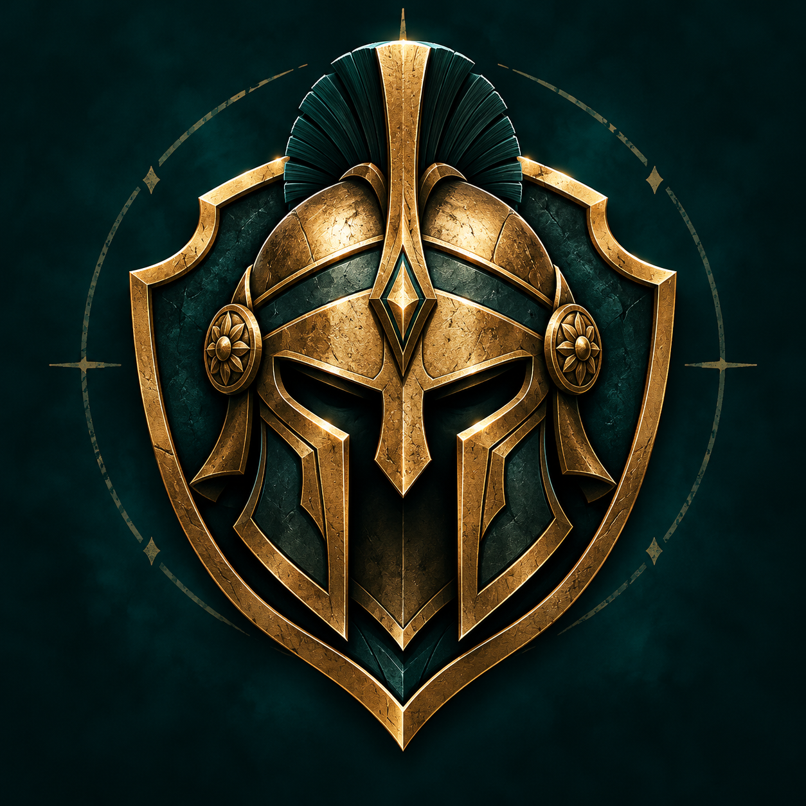
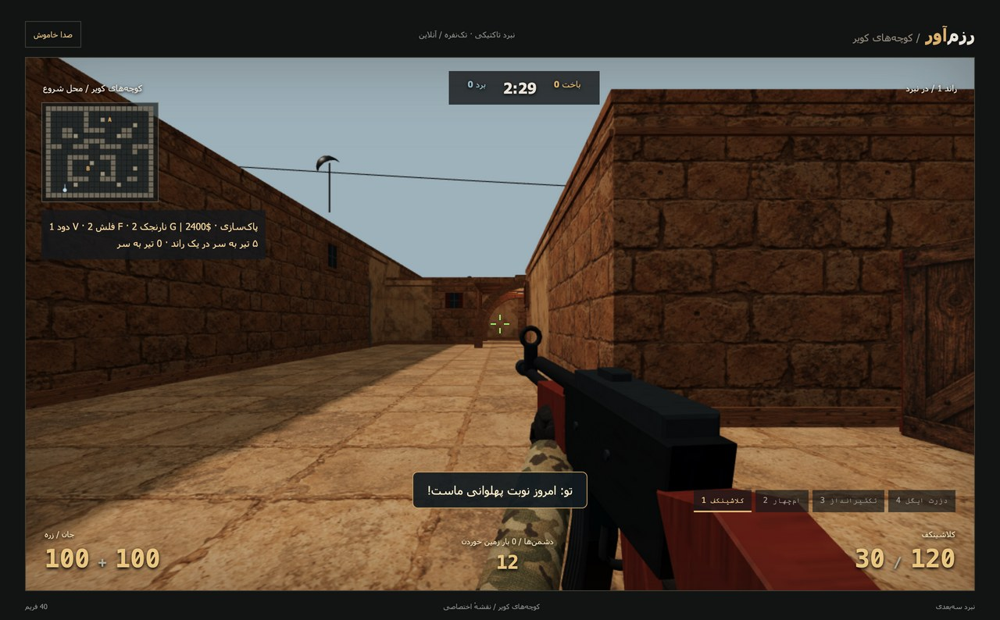
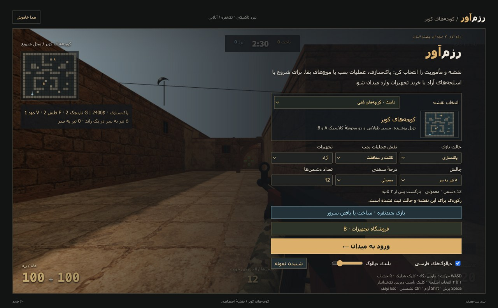
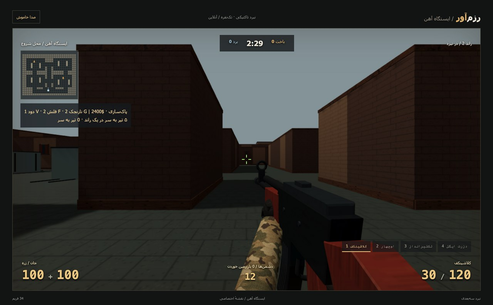
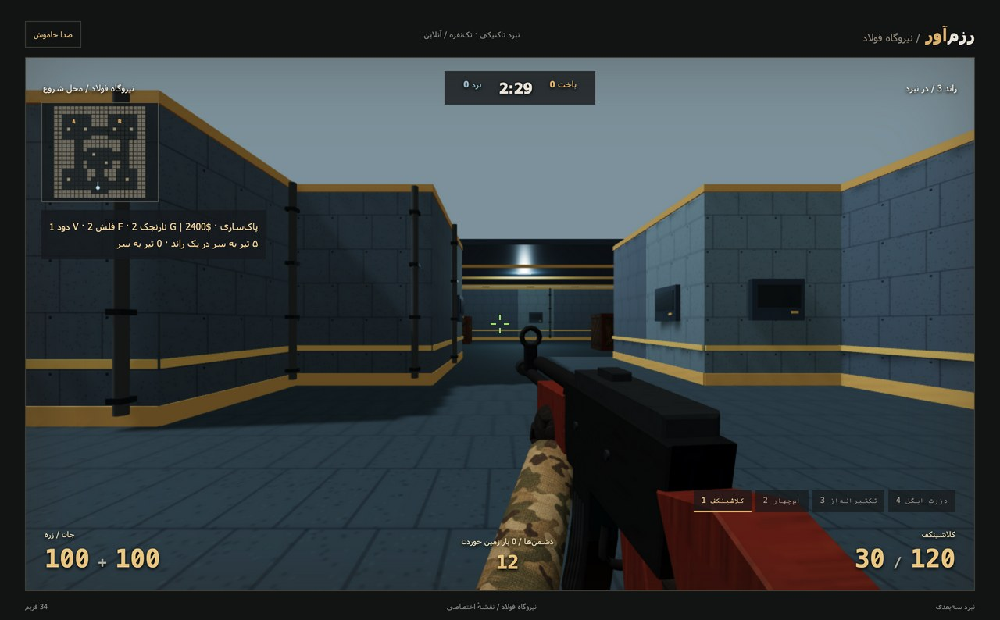
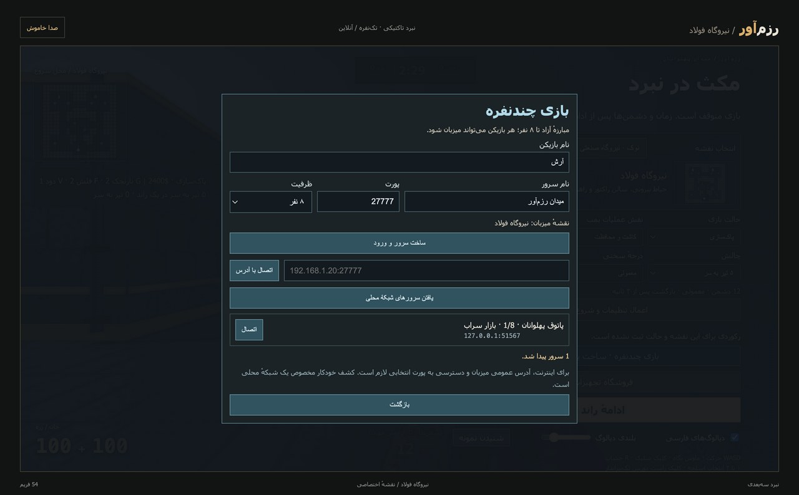
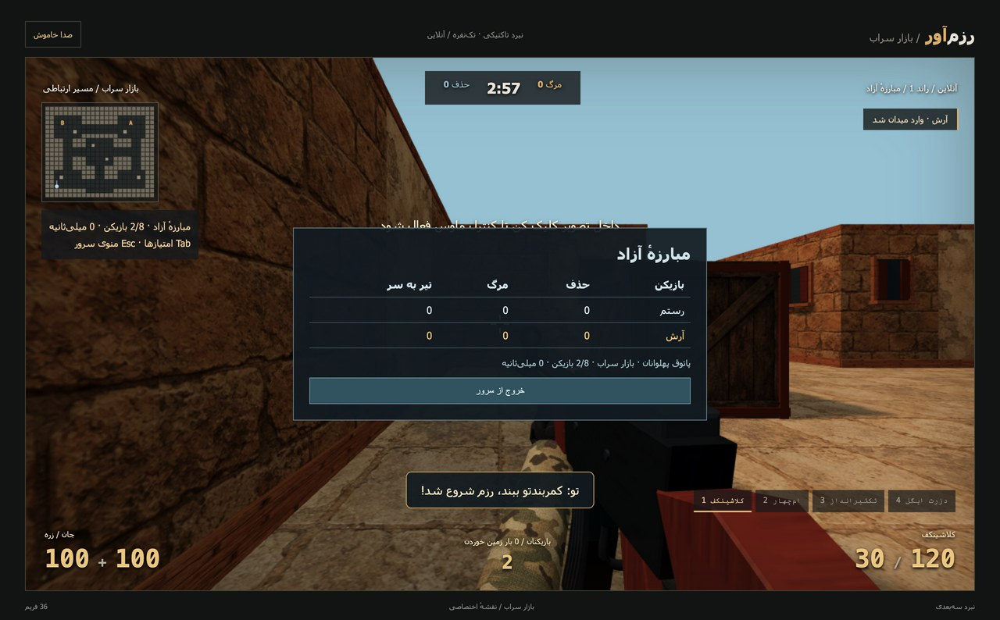

<div align="center" dir="rtl">



<h1>⚔️ رزم‌آور</h1>
<p><strong>میدان پهلوانان؛ تیراندازی سه‌بعدی با حال‌وهوای ایرانی</strong></p>
<p>۵ نقشه · نبرد تک‌نفره و آنلاین · ۵۳ دیالوگ صوتی فارسی · میزبانی شخصی</p>



<p><em>«حریفت منم!» — فقط حواست به خشاب باشه.</em></p>

</div>

رزم‌آور یک بازی تیراندازی اول‌شخص با **Electron و Three.js** است. در کوچه‌های کویر بجنگ، بمب را خنثی کن، موج‌های دشمن را پشت سر بگذار یا سرور خودت را بساز و با دوستانت روبه‌رو شو. ربات‌هایی مثل **رستم، آرش و گردآفرید** هم وسط نبرد بی‌حرف نمی‌مانند!

تمام تصاویر محیط بازی در این صفحه از **نسخهٔ فعلی خود بازی** گرفته شده‌اند. فایل‌های عکس داخل پروژه‌اند و برای نمایش به سرویس خارجی وابسته نیستند.

**راهنما:** [اجرای سریع](#quick-start) · [اولین نبرد](#first-match) · [کنترل‌ها](#controls) · [حالت‌ها](#modes) · [نقشه‌ها](#maps) · [بازی آنلاین](#multiplayer) · [صدا](#voice) · [رفع مشکل](#troubleshooting) · [توسعه](#development)

---

<a id="quick-start"></a>

## 🚀 نصب و اجرای سریع

برای اجرای سورس به **Node.js ۲۴، npm و پشتیبانی گرافیکی WebGL** نیاز داری. نسخه‌های بسته‌بندی‌شده به نصب Node.js نیاز ندارند؛ راهنمای دریافت آن‌ها در بخش بیلد آمده است.

برای دریافت سورس از GitHub:

```sh
git clone https://github.com/alihajiali/razm_avar.git
cd razm_avar
npm ci
npm start
```

اگر پوشهٔ پروژه را از قبل داری، داخل همان پوشه `npm ci` و سپس `npm start` را اجرا کن.

اگر وابستگی‌ها قبلاً نصب شده‌اند، فقط `npm start` را اجرا کن. حالت تک‌نفره و فایل‌های صوتی بعد از نصب **آفلاین** کار می‌کنند. برای چندنفره، بازی را روی دستگاه هر بازیکن با Electron اجرا کن.

<a id="first-match"></a>

## 🎮 اولین نبرد، قدم‌به‌قدم



1. **نقشه را انتخاب کن.** پیش‌نمایش کوچک، مسیرها و محوطه‌های A و B را نشان می‌دهد.
2. برای شروع، حالت **پاک‌سازی**، تجهیزات **آزاد** و سختی **آسان** را انتخاب کن. تعداد دشمن‌ها از ۱ تا ۲۴ قابل تنظیم است.
3. «**ورود به میدان**» را بزن؛ اگر کنترل ماوس فعال نشد، داخل تصویر کلیک کن.
4. با `WASD` حرکت کن، با ماوس نشانه بگیر و با کلیک چپ شلیک کن. دیوارها و جعبه‌ها برای پناه‌گرفتن به کار می‌آیند.
5. با `R` خشاب عوض کن. مهمات هر اسلحه مستقل است؛ با کلیدهای `1` تا `4` اسلحه عوض کن.
6. با `Esc` بازی تک‌نفره را متوقف کن. «ادامهٔ راند» پیشرفت را حفظ می‌کند؛ برای تغییر نقشه یا تنظیمات، «اعمال تنظیمات و شروع راند جدید» را بزن.

**زمین خوردی؟** در تک‌نفره پس از ۳ ثانیه با جان، زره و مهمات کامل برمی‌گردی و ۳ ثانیه محافظت داری. دشمن‌های حذف‌شده دوباره زنده نمی‌شوند. تنظیمات و بهترین رکورد هر ترکیب نقشه و حالت روی دستگاه ذخیره می‌شوند.

> 💡 هنگام حرکت دقت کمتر است؛ نشستن دقت را بهتر می‌کند. پیش از ورود به مسیر باز، خشاب و رادار را نگاه کن.

<a id="controls"></a>

## ⌨️ کنترل‌ها

| کلید یا ورودی | کار |
| :--- | :--- |
| `W` `A` `S` `D` | حرکت |
| ماوس / کلیدهای جهت | نگاه و نشانه‌گیری |
| کلیک چپ | شلیک؛ نگه‌داشتن برای کلاشینکف و ام‌چهار |
| کلیک راست | دوربین تک‌تیرانداز |
| `1` تا `4` / چرخ ماوس | تعویض اسلحه |
| `R` | خشاب‌گذاری |
| `Space` | پرش |
| `Shift` | حرکت آرام |
| `Ctrl` | نشستن |
| `G` / `F` / `V` | نارنجک انفجاری / فلش / دود؛ در تک‌نفره |
| `E` | کاشت یا خنثی‌سازی بمب؛ نگه دار |
| `B` | فروشگاه تجهیزات؛ در تک‌نفره |
| `Tab` | جدول امتیاز آنلاین |
| `Esc` | توقف تک‌نفره / بازکردن منوی آنلاین |

### چهار اسلحه، چهار انتخاب

| اسلحه | خشاب / ذخیره | سبک بازی |
| :--- | :---: | :--- |
| **کلاشینکف — AK-47** | ۳۰ / ۱۲۰ | خودکار، آسیب بیشتر و لگد بیشتر |
| **ام‌چهار — M4A1** | ۳۰ / ۱۲۰ | خودکار، سریع‌تر و دقیق‌تر |
| **تک‌تیرانداز — AWP** | ۱۰ / ۳۰ | تک‌تیر، دوربین‌دار، شلیک با فاصلهٔ بیشتر |
| **دزرت ایگل** | ۷ / ۴۲ | نیمه‌خودکار؛ مناسب وقتی خشاب اصلی خالی است |

<a id="modes"></a>

## 💣 مأموریتت را انتخاب کن

| حالت | هدف | راه موفقیت |
| :--- | :--- | :--- |
| **پاک‌سازی** | تمام دشمن‌ها را در ۱۵۰ ثانیه حذف کن. | مسیرها را پاک کن؛ پس از آخرین حذف، پایان راند ۳ ثانیه طول می‌کشد. |
| **بمب؛ کاشت و محافظت** | بمب را در A یا B بکار و تا انفجار محافظت کن. | در فاصلهٔ ۴ متری مرکز محوطه، `E` را ۳ ثانیه نگه دار؛ سپس ۴۰ ثانیه دفاع کن. |
| **بمب؛ خنثی‌سازی** | قبل از انفجار به بمب برس. | ۹۰ ثانیه فرصت داری؛ کنار بمب `E` را ۵ ثانیه نگه دار. |
| **بقا** | موج‌های پی‌درپی را پشت سر بگذار. | هر موج ۲ دشمن اضافه می‌شود، تا سقف ۲۴؛ بین موج‌ها ۸ ثانیه فرصت تجهیز داری. |
| **مبارزهٔ آزاد آنلاین** | با دیگر بازیکنان مبارزه کن و بیشترین حذف را بگیر. | مسابقهٔ ۱۸۰ ثانیه‌ای، چهار اسلحهٔ آزاد و جدول امتیاز زنده. |

در مأموریت کاشت، دشمن نزدیک بمب می‌تواند آن را طی ۸ ثانیه خنثی کند؛ حذف همهٔ دشمن‌ها به‌تنهایی این مأموریت را تمام نمی‌کند. در بقا، جان، زره و مهمات بین موج‌ها بازیابی می‌شوند.

### تجهیزات، چالش و تاکتیک

- **آزاد یا خریدنی:** در حالت آزاد همهٔ اسلحه‌ها در دسترس‌اند. حالت خرید با کلت و ۲۴۰۰ واحد پول شروع می‌شود.
- **فروشگاه:** با `B` در منو، بین موج‌ها یا نزدیک محل شروع طی ۲۰ ثانیهٔ اول راند خرید کن. هر حذف ۳۰۰ واحد پول می‌دهد.
- **نارنجک‌ها:** انفجاری برای آسیب، فلش برای کورکردن و دود برای قطع دید دشمن. انفجاری می‌تواند به خودت هم آسیب بزند؛ دود ۱۲ ثانیه می‌ماند.
- **دشمن‌های متفاوت:** مهاجم، دورزن، تک‌تیرانداز و پناه‌گیر رفتارهای متفاوت دارند.
- **چالش‌ها:** ۵ حذف با تیر به سر، برد بدون مرگ یا برد فقط با کلت. گزارش پایان راند، دقت، حذف‌ها، مرگ‌ها و زمان را نشان می‌دهد.

<a id="maps"></a>

## 🗺️ پنج میدان برای پنج حال‌وهوا

| نقشه | چیزی که در میدان می‌بینی |
| :--- | :--- |
| **کوچه‌های کویر** | دیوارهای شنی، تونل و مسیر طولانی؛ الهام از فضای Dust |
| **بازار سراب** | حیاط مرکزی، آب‌نما، بازار و کاخ؛ الهام از فضای Mirage |
| **دهکدهٔ آتش** | کوچهٔ خمیده، بالکن‌ها و میدان دهکده؛ الهام از فضای Inferno |
| **نیروگاه فولاد** | سالن‌های سقف‌دار، مخازن و حیاط صنعتی؛ الهام از فضای Nuke |
| **ایستگاه آهن** | واگن‌های باری، ریل و انبار؛ الهام از فضای Train |

| ایستگاه آهن | نیروگاه فولاد |
| :---: | :---: |
|  |  |

چیدمان نقشه‌ها متعلق به همین پروژه است و از فضاهای کلاسیک الهام گرفته‌اند. هر پنج نقشه در مأموریت‌های تک‌نفره و مبارزهٔ آنلاین قابل انتخاب‌اند. نیروگاه در این نسخه یک سطح قابل حرکت دارد.

<a id="multiplayer"></a>

## 🌐 با دوستانت آنلاین بجنگ

### ۱. میزبان یک سرور بسازد

1. بازی را با `npm start` باز کن و نقشه را انتخاب کن.
2. «**بازی چندنفره · ساخت یا یافتن سرور**» را بزن.
3. نام بازیکن، نام سرور و ظرفیت **۲، ۴ یا ۸ نفر** را تعیین کن.
4. پورت پیش‌فرض `27777` را نگه دار و «**ساخت سرور و ورود**» را بزن.
5. با `Tab` آدرس‌های اتصال دستگاهت را ببین و آدرس مناسب را به دوستانت بده.

### ۲. بقیه وارد شوند

اگر دستگاه‌ها به یک شبکهٔ محلی وصل‌اند، «**یافتن سرورهای شبکهٔ محلی**» را بزنند و کنار سرور دلخواه «اتصال» را انتخاب کنند. برای اتصال مستقیم، آدرس میزبان را وارد کنند؛ مثلاً:

```text
192.168.1.20:27777
```

این آدرس نمونه است؛ باید آن را با آدرس دستگاه میزبان جایگزین کنی.

| پیدا کردن سرور | جدول امتیاز |
| :---: | :---: |
|  |  |

### قوانین میدان آنلاین

- هر مسابقه **۱۸۰ ثانیه** است؛ پس از پایان، **۸ ثانیه** تا مسابقهٔ بعد فاصله است.
- بعد از مرگ، **۳ ثانیه** منتظر می‌مانی و با **۲ ثانیه محافظت** برمی‌گردی.
- رتبه‌بندی با حذف بیشتر و سپس مرگ کمتر انجام می‌شود.
- `Tab` امتیازها را نشان می‌دهد؛ `Esc` منو را باز می‌کند. **مسابقه با بازشدن منو متوقف نمی‌شود.**
- خروج میزبان، سرور را می‌بندد و دیگر بازیکنان به منو برمی‌گردند.
- بمب، بقا، فروشگاه و نارنجک‌ها در این نسخه مخصوص تک‌نفره‌اند.

<details>
<summary><strong>اتصال از طریق اینترنت و تنظیم پورت‌ها</strong></summary>

کشف خودکار، مخصوص **شبکهٔ محلی** است. برای اینترنت، با آدرس عمومی یا دامنهٔ میزبان و پورت بازی متصل شو. میزبان باید اتصال ورودی **TCP** روی پورت انتخابی را بپذیرد؛ پشت روتر، هدایت پورت به دستگاه میزبان و اجازهٔ فایروال لازم است.

| کاربرد | پروتکل | پورت پیش‌فرض |
| :--- | :---: | :---: |
| اتصال و مسابقه | TCP | `27777` |
| کشف سرور در شبکهٔ محلی | UDP | `27778` |

اگر شبکه پشت CGNAT است، میزبانی مستقیم با آدرس عمومی روتر معمولاً ممکن نیست؛ از شبکهٔ مجازی مشترک یا میزبان دارای IP عمومی استفاده کن. فهرست عمومی اینترنتی یا سرویس مرکزی در این نسخه وجود ندارد.

</details>

<a id="voice"></a>

## 🎙️ پهلوان‌ها هم دیالوگ دارند

**۵۳ جملهٔ طنز و حماسی** با صدای مصنوعی فارسی و زیرنویس، به اتفاق‌های نبرد وصل شده‌اند:

| اتفاق | نمونهٔ دیالوگ |
| :--- | :--- |
| شروع نبرد | «حریفت منم!» |
| تیرخوردن | «آخ تیر خوردم!» |
| زمین‌خوردن | «چرا منو کشتی؟» |
| خشاب‌گذاری | «خشاب عوض می‌کنم، هوامو داشته باش!» |
| بازگشت | «پهلوان دوباره پا شد!» |
| پیروزی | «پیروزی مبارک، حالا وقت چایه!» |

در منو، **دیالوگ‌های فارسی** را روشن یا خاموش کن، **بلندی دیالوگ** را تنظیم کن یا «**شنیدن نمونه**» را بزن. دکمهٔ «صدا» بالای صفحه همهٔ صداها را قطع می‌کند. تنظیم دیالوگ‌ها برای اجرای بعدی ذخیره می‌شود؛ هم‌زمان فقط یک جمله پخش می‌شود.

صداها داخل [assets/voices](assets/voices) قرار دارند و به اینترنت یا نصب صدای فارسی سیستم نیاز ندارند. مشخصات منبع تولید در [راهنمای فایل‌های صوتی](assets/voices/README.md) آمده است.

<a id="troubleshooting"></a>

## 🛠️ اگر چیزی درست کار نکرد

| مشکل | راه بررسی |
| :--- | :--- |
| ماوس نگاه را کنترل نمی‌کند | بعد از «ورود به میدان»، داخل تصویر کلیک کن. کلیدهای جهت هم برای نگاه در دسترس‌اند. |
| صفحهٔ سه‌بعدی بالا نمی‌آید | بازی را با Electron اجرا کن؛ پشتیبانی WebGL و شتاب‌دهی گرافیکی دستگاه را بررسی کن. |
| دیالوگ شنیده نمی‌شود | «صدا روشن»، تیک «دیالوگ‌های فارسی» و بلندی دیالوگ را بررسی کن؛ بعد «شنیدن نمونه» را بزن. |
| سروری در فهرست نیست | مطمئن شو میزبان سرور ساخته و هر دو دستگاه در یک شبکه‌اند؛ اتصال مستقیم با IP محلی را امتحان کن. |
| پورت در حال استفاده است | میزبان پورت دیگری انتخاب کند و دیگران همان پورت را در آدرس اتصال وارد کنند. |
| نقشه یا سختی عوض نشده | در حالت توقف، «اعمال تنظیمات و شروع راند جدید» را بزن؛ ادامهٔ راند تنظیمات فعلی را حفظ می‌کند. |

اگر روی macOS متغیر `ELECTRON_RUN_AS_NODE` در محیطت تنظیم شده و اجرای معمول باز نمی‌شود:

```sh
env -u ELECTRON_RUN_AS_NODE npm start
```

<a id="development"></a>

## 🧩 راهنمای توسعه

| فایل یا پوشه | مسئولیت |
| :--- | :--- |
| [game.js](game.js) | جریان بازی، کنترل‌ها، رابط و اتصال نمایش به رویدادها |
| [graphics.mjs](graphics.mjs) | محیط سه‌بعدی، سربازها، اسلحه‌ها و انیمیشن |
| [arena.mjs](arena.mjs) / [maps.mjs](maps.mjs) | اسلحه‌ها، برخورد، مسیریابی و تعریف نقشه‌ها |
| [operations.mjs](operations.mjs) | بمب، نارنجک، فروشگاه، چالش‌ها و بقا |
| [multiplayer-world.mjs](multiplayer-world.mjs) / [network.cjs](network.cjs) | منطق معتبر سرور، ارتباط TCP و کشف محلی |
| [main.cjs](main.cjs) / [preload.cjs](preload.cjs) / [network-ipc.cjs](network-ipc.cjs) | پنجرهٔ Electron و رابط محدود شبکه |
| [dialogues.mjs](dialogues.mjs) / [voice.mjs](voice.mjs) | متن دیالوگ‌ها، نام‌های ایرانی و مدیریت پخش صدا |
| [assets](assets) / [vendor](vendor) | بافت‌ها، صداهای آماده و فایل‌های محلی Three.js |
| [scripts](scripts) | بررسی منطق، شبکه و اجرای واقعی بازی |
| [docs/images](docs/images) | عکس‌های همین README |

### قالب‌بندی کد

کدهای پروژه با تورفتگی دو فاصله و سبک یکسان نوشته می‌شوند. تنظیمات ویرایشگر در `.editorconfig` و تنظیمات قالب‌بندی در `.prettierrc.json` قرار دارند.

```sh
# مرتب‌کردن کدها
npm run format

# بررسی قالب‌بندی بدون تغییر فایل‌ها
npm run format:check
```

### بررسی پروژه

```sh
# بررسی نگارش کدها
npm run check

# منطق بازی، نقشه‌ها، چندنفره و دیالوگ‌ها
npm test

# اتصال واقعی TCP و کشف محلی؛ نیازمند امکان بازکردن پورت محلی
npm run test:network

# رابط فارسی، پخش واقعی صدا و ذخیرهٔ تنظیمات در Electron؛ روی macOS
npm run test:persian
```

برای بررسی گرافیکی کامل‌تر، اسکریپت‌های `runtime-smoke.cjs`، `maps-runtime.cjs` و `operations-runtime.cjs` داخل `scripts` هستند. نمونهٔ اجرا روی macOS:

```sh
env -u ELECTRON_RUN_AS_NODE node_modules/.bin/electron scripts/maps-runtime.cjs
```

### بیلد خودکار برای Windows، Linux و macOS

گردش‌کار [Build desktop apps](.github/workflows/build.yml) بعد از هر پوش روی `main`، درخواست ادغام یا تگ `v*` اجرا می‌شود. از تب [Actions](https://github.com/alihajiali/razm_avar/actions/workflows/build.yml) هم می‌توان آن را با **Run workflow** دستی اجرا کرد.

ابتدا قالب‌بندی، نگارش JavaScript، منطق بازی و شبکه بررسی می‌شوند؛ سپس شش بیلد مستقل ساخته می‌شود:

| سیستم | معماری | خروجی |
| :--- | :--- | :--- |
| Windows | x64 و ARM64 | نصب‌کنندهٔ EXE و آرشیو ZIP |
| Ubuntu / Debian | x64 و ARM64 | بستهٔ DEB |
| Fedora و توزیع‌های RPM | x64 و ARM64 | بستهٔ RPM |
| Linux | x64 و ARM64 | AppImage |
| macOS Intel | x64 | DMG و ZIP |
| macOS Apple Silicon؛ سری M | ARM64 | DMG و ZIP |

**دریافت خروجی:** در Actions اجرای موفق را باز کن، به بخش **Artifacts** برو و بستهٔ متناسب با سیستم و پردازنده‌ات را دانلود کن. نام هر artifact مثل `razm-avar-mac-arm64` است و به مدت ۳۰ روز نگه داشته می‌شود. فایل‌های قابل نصب داخل ZIP دانلودشده قرار دارند؛ فایل‌های بیلد در Git ثبت نمی‌شوند.

اکشن مک، برنامهٔ بسته‌بندی‌شده را پیش از آپلود اجرا می‌کند و بالا آمدن پردازش گرافیکی را بررسی می‌کند. برای نام فارسی، `mac.extendInfo.CFBundleName` با Unicode NFD ذخیره شده تا با نام پردازش‌های کمکی ساخته‌شده توسط بسته‌ساز یکسان باشد؛ تغییر این مقدار بدون یکسان‌سازی می‌تواند باعث کرش هنگام اجرا شود.

بیلدهای Linux روی runner اوبونتو ساخته می‌شوند؛ DEB برای اوبونتو و RPM برای فدورا ارائه می‌شود. سازگاری گرافیکی و اجرای واقعی روی نسخهٔ توزیع و دستگاه کاربر باید جداگانه بررسی شود.

### ساخت روی دستگاه خودت

فرمان متناسب با سیستم عاملت را اجرا کن:

```sh
# Windows: EXE + ZIP
npm run build:win

# Linux: AppImage + DEB + RPM
npm run build:linux

# macOS: DMG + ZIP برای معماری دستگاه فعلی
npm run build:mac

# macOS Apple Silicon
npm run build:mac:arm64

# macOS Intel
npm run build:mac:x64
```

برای ساخت بسته‌های Linux، ابزار `rpm` و `libarchive-tools` هم لازم‌اند. خروجی‌ها در `dist/` قرار می‌گیرند. بیلدهای فعلی بدون امضای تجاری Windows و بدون امضا و notarization اپل هستند؛ این مرحله برای انتشار رسمی باید جداگانه تنظیم شود.

### آیکون برنامه

لوگوی اصلی در [assets/branding/logo.png](assets/branding/logo.png) قرار دارد. تنظیمات `mac.icon`، `win.icon` و `linux.icon` در `package.json` همگی به همین فایل اشاره می‌کنند؛ GitHub Actions آن را هنگام بسته‌بندی به آیکون مورد نیاز هر سیستم‌عامل تبدیل می‌کند. فایل اجرایی و نصب‌کنندهٔ Windows، برنامهٔ macOS و بسته‌های Linux از همین لوگو استفاده می‌کنند. مسیر فایل و پرامپت ساخت در [راهنمای لوگو](assets/branding/README.md) ثبت شده است.

### دارایی‌ها و منابع

مدل‌ها و چیدمان نقشه‌ها در پروژه ساخته شده‌اند. توضیح بافت‌های تولیدشده در [assets/GENERATED.md](assets/GENERATED.md)، منبع صدا در [assets/voices/README.md](assets/voices/README.md) و مجوز Three.js در [vendor/THREE-LICENSE.txt](vendor/THREE-LICENSE.txt) قرار دارد.

---

<div align="center" dir="rtl">
<p><strong>رزم‌آور — پهلوان دوباره پا می‌شود.</strong></p>
<p>اول خشاب، بعد رجزخوانی! ⚔️</p>
</div>
